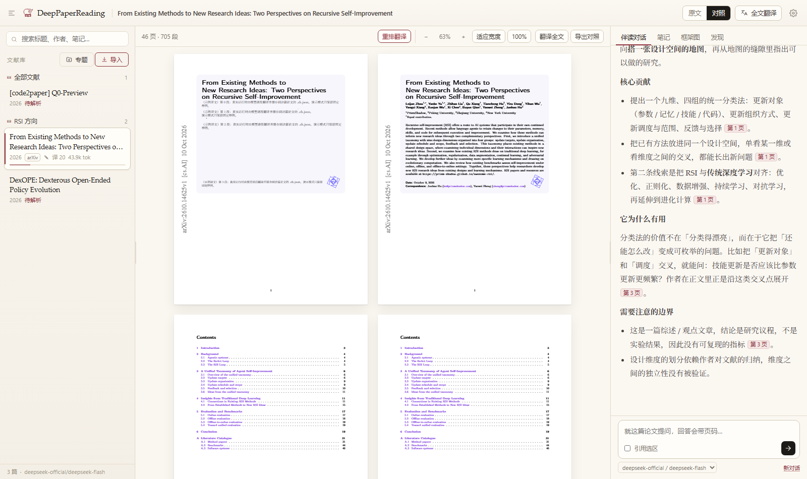
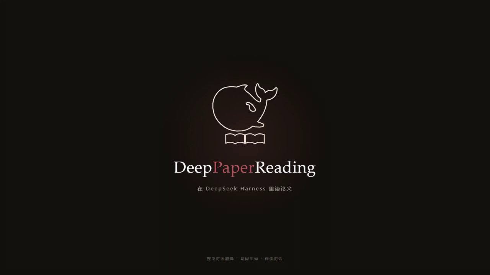

<p align="center">
  
</p>

<h1 align="center">DeepPaperReading</h1>

<p align="center">
  <b>Read papers inside DeepSeek Harness</b><br />
  Page-level bilingual view · select-to-translate · paper-aware chat · notes &amp; sync
</p>

<p align="center">
  <b>English</b> · <a href="README.md">中文</a>
</p>

<p align="center">
  
  
  
  
</p>

---

<p align="center">
  
</p>

## Why

Reading an English paper usually means: looking words up in the PDF, translating the page in a browser, asking an AI in another window, and keeping notes somewhere else.

DeepPaperReading puts **the PDF, the translation, the chat, the notes and the diagrams** on one screen inside DSH — grouped per paper, stored on your machine.

| | Feature | What it does |
|---|---|---|
| 📥 | **Import** | Local PDF, arXiv ID, arXiv link, any `.pdf` URL — or drag and drop |
| 📖 | **Original view** | Rendered as-is: zoom and scrollbars, no re-typesetting; selectable text |
| 🀄 | **Bilingual pages** | Chinese page left, original right, page by page |
| 🔍 | **Selection translation** | Drag over a sentence; the card appears next to the cursor |
| 💬 | **Paper chat** | Whole-paper outline + retrieved passages, `[p.12]` citations, KaTeX |
| 📝 | **Notes** | Per-paper Markdown notes, saved as you type |
| 🧭 | **Diagrams** | Turn the paper's structure into a node graph, with history |
| ☁️ | **Sync** | Folder / WebDAV / Google Drive / Baidu Netdisk sync space |
| 📚 | **Discover** | alphaXiv similar papers + HuggingFace daily trending |
| 🔢 | **Tokens** | Per-paper usage, split by chat / translation |

## Demo

<p align="center">
  <a href="docs/deeppaperreading-demo.mp4">
    
  </a>
  <br />
  <sub>48 s · logo animation + guided tour (<a href="docs/deeppaperreading-demo.mp4">MP4</a>)</sub>
</p>

## Getting started

```bash
git clone <repo> DeepPaperReading
cd DeepPaperReading
node dev/server.mjs     # standalone preview: http://127.0.0.1:7788/paper-studio/
```

Enable it inside DSH:

```jsonc
// ~/.dsh/profiles/<profile>/package.json
{
  "dependencies": { "dsh-paper-studio": "link:D:/path/to/DeepPaperReading" },
  "dsh": { "bundles": ["dsh-paper-studio"] }
}
```

Restart DSH and the **DeepPaperReading** icon appears in the sidebar. Host changes need a restart; web assets only need a panel reload.

## Usage

<details open>
<summary><b>Import &amp; reading</b></summary>

Click **Import** in the left rail: `2410.12345`, `arXiv:2410.12345`, `https://arxiv.org/abs/…` or any `.pdf` URL — or pick a local file / drop it in.

The mouse is for **selecting text** only: zoom with `− / % / +`, **Fit width**, **100%**, or `Ctrl/Cmd + wheel`; use the **horizontal scrollbar** when zoomed in.

</details>

<details>
<summary><b>Selection translation</b></summary>

Drag over any text → a card appears **next to the cursor**: source above, streaming translation below, with *Ask about this / Add to notes / Copy*.

The text layer is pdf.js's own, so whole lines and paragraphs select naturally. Translation uses a lean prompt plus a local cache — selecting the same snippet again is instant.

</details>

<details>
<summary><b>Full-text translation</b></summary>

Click **Translate all** and switch to **Bilingual**: a Chinese page on the left, the original on the right.

The Chinese page is not a re-typeset PDF: paragraph boxes, sizes and positions come from extraction, the translation is written back into the same box, and the original is covered with a **background colour sampled from the page** (tinted boxes stay tinted). Type shrinks to fit the block. Zoom never jumps pages — the reader restores the same page and offset.

Quality comes from three things: a **per-paper glossary** (built on the first full translation, then injected into every call), the **section each paragraph belongs to**, and explicit Chinese-prose rules (split long sentences, resolve pronouns, keep logical connectives). **Text inside figures is left alone** (short labels, margin stamps, anything under 7.4pt).

Translation is idempotent: clicking again while running stops it; finished paragraphs are cached; **a different model invalidates the cache** and re-translates.

> For a genuinely re-typeset Chinese PDF use **Re-typeset** (BabelDOC): `winget install --id astral-sh.uv -e`, then `uv tool install --python 3.12 BabelDOC`, plus an OpenAI-compatible API key.

</details>

<details>
<summary><b>Paper chat</b></summary>

Every question carries a **whole-paper outline** (title, first-page abstract, every section heading and its page) plus the **12 most relevant passages**. Citations like `[p.12]` jump to the page.

Streaming can be stopped at any time, each answer can be copied or regenerated, and the model is selectable below the composer.

</details>

<details>
<summary><b>Sync &amp; tokens</b></summary>

Settings → Sync: folder / WebDAV / Google Drive / **Baidu Netdisk sync space** (auto-detected local folder, one-click bind).

Three-way merge; conflicts are written as copies under `conflicts/` instead of overwriting your work. A sync runs automatically after a translation finishes.

Each paper shows its accumulated tokens (e.g. `3.6k tok`) in the rail; the data lives in `papers/<id>/usage.json`.

</details>

## Settings

| Option | Notes |
|---|---|
| **Model source** | Auto (DSH account, falls back to a direct endpoint) / DSH account / Direct API key. One-click import from the older paper plugin |
| **Translation style** | Academic / plain / concise — applies to both full-text and selection translation |
| **Field** | Steers terminology |
| **Sync** | See above |

## Data &amp; privacy

```
~/.dsh/paper-studio/
  library.json            library
  config.json             settings (API key stays local)
  papers/<id>/
    paper.pdf  text.json  zh.json  notes.md
    chats.json figures.json usage.json babeldoc/
  .sync/state.json        sync snapshot
```

PDFs, extracted text, translations, notes and chats stay on your machine; they only leave it if you configure a sync target. API keys never appear in the page source, logs or synced files.

## Architecture

```
lib/   host side: routes, storage, model gateway, translation, retrieval, sync
web/   browser side: state + rendering, PDF extraction, design system
       vendor/ pdf.js, KaTeX
```

The panel registers a `sidebar.panellist` icon and mounts an iframe in the `main` slot; the host exposes `/paper-studio/*` through `webServer.register` and reuses DSH's connection auth.

## Development

```bash
node dev/server.mjs       # preview with a stub model
node dev/api-test.mjs     # 16 API checks
node dev/sync-test.mjs    # 14 sync checks
node dev/llm-test.mjs     # model gateway and fallback
node dev/client-test.mjs  # client bundle registration
node dev/record.mjs <appUrl> docs/demo.mp4   # record the demo video
```

## Known limits

1. **The bilingual view is an overlay, not re-typesetting** — a shorter translation leaves whitespace inside its block. Use BabelDOC for true re-layout.
2. A page can be mixed Chinese/English: skipped figure labels and margins stay in English.
3. Token counts are estimates unless the provider returns usage.
4. Scanned PDFs have no text layer and need OCR (not built in).
5. Sync is serial; a large library takes a while on first upload.

## License

MIT · built on [pdf.js](https://mozilla.github.io/pdf.js/) and [KaTeX](https://katex.org/)
