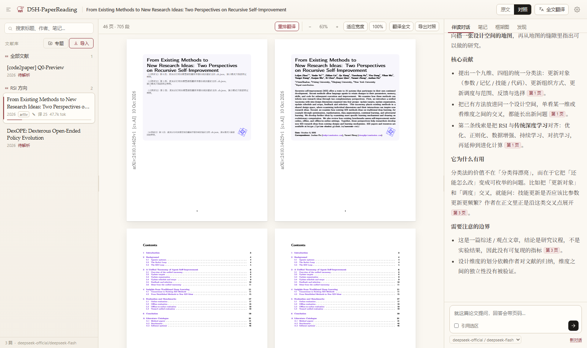
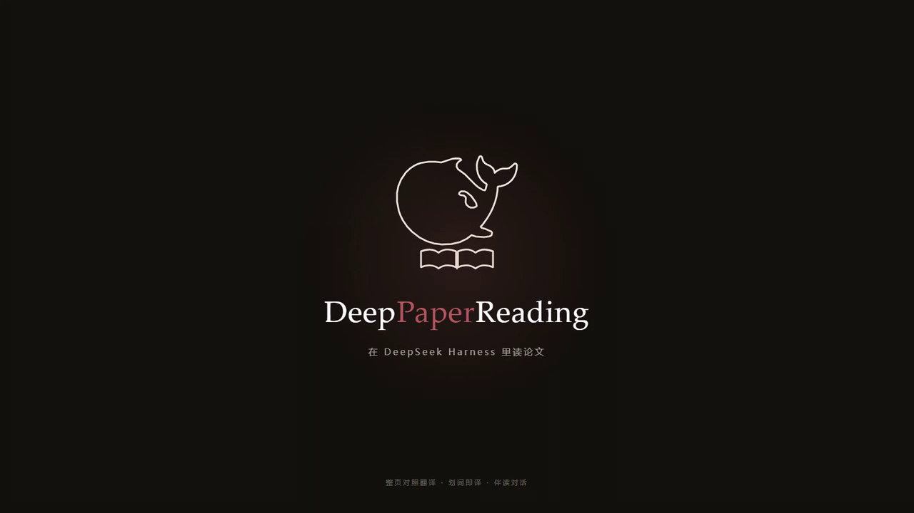

<p align="center">
  
</p>

<h1 align="center">DSH-PaperReading</h1>

<p align="center">
  <b>在 DeepSeek Harness 里读论文</b><br />
  整页对照翻译 · 划词即译 · 伴读对话 · 笔记与同步
</p>

<p align="center">
  <a href="README.en.md">English</a> · <b>中文</b>
</p>

<p align="center">
  
  
  
  
</p>

---

<p align="center">
  
</p>

## 为什么

读英文论文通常是这样的：PDF 里查词、浏览器里翻译整页、另一个窗口问 AI、笔记再记在第三个地方。

DeepPaperReading 把这些收进 DSH 的一个侧栏面板：**原文、译文、对话、笔记、框架图**都在同一屏，而且全部按论文归集、存在本机。

| | 能力 | 说明 |
|---|---|---|
| 📥 | **导入** | 本地 PDF、arXiv 编号、arXiv 链接、任意 `.pdf` 地址，或直接拖进来 |
| 📖 | **原版阅读** | 原样渲染，缩放 + 滚动条，不重排、不失真；文字层可选中 |
| 🀄 | **整页对照** | 左中文页 / 右原版页，逐页并排，版式跟着原文走 |
| 🔍 | **划词翻译** | 拖选任意一句，光标旁浮出译文卡片，可提问 / 记笔记 / 复制 |
| 💬 | **伴读对话** | 全文概览 + 段落召回，回答带 `[p.12]` 页码，公式用 KaTeX 渲染 |
| 📝 | **笔记** | 按论文的 Markdown 笔记，输入即存 |
| 🧭 | **框架图** | 把论文结构画成节点图，可回看历史 |
| ☁️ | **同步** | 本地文件夹 / WebDAV / Google Drive / 百度网盘同步空间 |
| 📚 | **发现** | alphaXiv 相似论文 + HuggingFace 每日热点 |
| 🔢 | **Token 记账** | 每篇论文的累计消耗，按对话 / 翻译拆分 |

## 视频演示

<p align="center">
  <a href="docs/deeppaperreading-demo.mp4">
    
  </a>
  <br />
  <sub>48 秒 · logo 动效开场 + 分镜演示（<a href="docs/deeppaperreading-demo.mp4">MP4</a>）</sub>
</p>

## 快速开始

三种装法，任选其一。

**① 直接从 GitHub 装**（最快，不需要 npm 账号）

```bash
# Git 地址
dsh plugin --profile web add https://github.com/wuke-luke/DSH-PaperReading

# 或 Release 里的预构建包（3.3 MB）
# https://github.com/wuke-luke/DSH-PaperReading/releases/latest
dsh plugin --profile web add ./dsh-paperreading-0.6.4.tgz
```

**② 从插件市场 / npm**（条目合入后可用；npm 网页版在部分网络下 403，装包走 registry 不受影响）

```bash
dsh plugin add dsh-paperreading
```

> `dsh plugin add` 接受：包名、带版本号、Git 地址、tarball、本地绝对路径。DSH 里的「安装插件」对话框同样支持这几种。

**③ 从源码**（改动调试用）

```bash
git clone https://github.com/wuke-luke/DSH-PaperReading DSH-PaperReading
cd DSH-PaperReading
node dev/server.mjs     # 独立预览 http://127.0.0.1:7788/paper-studio/
```

挂进 DSH profile：

```jsonc
// ~/.dsh/profiles/<profile>/package.json
{
  "dependencies": { "dsh-paperreading": "link:D:/path/to/DSH-PaperReading" },
  "dsh": { "bundles": ["dsh-paperreading"] }
}
```

重启 DSH，左侧栏出现 **DSH-PaperReading**。宿主改动需重启，前端资源刷新面板即可。

## 使用

<details open>
<summary><b>导入与阅读</b></summary>

点左栏「导入」：`2410.12345`、`arXiv:2410.12345`、`https://arxiv.org/abs/…` 或任意 `.pdf` 链接；也可选本地文件或拖入。

阅读时鼠标只用来**选字**：缩放用顶栏 `− / % / +`、`适应宽度`、`100%` 或 `Ctrl/Cmd + 滚轮`，超出视野用**底部横向滚动条**。

</details>

<details>
<summary><b>划词翻译</b></summary>

拖选任意文字 → **光标旁**浮出卡片：上方原文、下方流式译文，可「就这段提问 / 记入笔记 / 复制译文」。

文字层是 pdf.js 原生 text layer，整行整段连续可选；翻译走轻量通道（短提示词 + 本地缓存），重复选同一段是瞬时的。

</details>

<details>
<summary><b>全文翻译</b></summary>

顶栏「全文翻译」，切到「对照」：**左中文页 / 右原版页** 逐页并排。

中文页不是重排 PDF，而是按原文版面回填：段落坐标与字号来自解析结果，译文写回同一位置，原位置用**从页面采样到的背景色**覆盖，字号按块高自动收缩。缩放不会跳页——按「当前看到的页 + 页内偏移」还原。

译文质量靠三件事：**每篇论文一份术语表**（首次全文翻译时自动生成并缓存，之后每次调用都带上）、**段落所属章节**（帮助指代还原）、以及一套明确的中文写作规则（拆长句、还原代词、逻辑连接词必须译出）。**图里的字不翻**（短标签、页边印章、< 7.4pt 注记直接跳过）。

翻译是幂等的：进行中再点 = 停止；译完再点只补未译；**换模型才会重译**。

> 想要真正重排版的中文 PDF，用「重排翻译」（BabelDOC）：先 `winget install --id astral-sh.uv -e`，再 `uv tool install --python 3.12 BabelDOC`，并配置一个 OpenAI 兼容的 Key。

</details>

<details>
<summary><b>伴读对话</b></summary>

每次提问会带**全文概览**（标题、首页摘要、章节标题与页码）+ **12 段最相关原文**；回答里的 `[p.12]` 可点击跳页。

流式输出可随时停止，每条回答可复制 / 重写，输入框下方可切换模型。

</details>

<details>
<summary><b>同步与 Token</b></summary>

设置 → 同步：本地文件夹 / WebDAV / Google Drive / **百度网盘同步空间**（自动检测本机同步目录，一键绑定）。

三路合并，冲突生成 `conflicts/` 副本，不覆盖你的稿子；翻译完成后自动同步一次。

左栏每篇论文显示累计 token（如 `3.6k tok`），数据在 `papers/<id>/usage.json`。

</details>

## 设置

| 项 | 说明 |
|---|---|
| **模型来源** | 自动（DSH 账号，失败回退直连）/ DSH 账号 / API Key 直连，可一键「从论文伴读导入 Key」 |
| **翻译风格** | 学术 / 通俗 / 简洁，同时作用于全文翻译与划词翻译 |
| **擅长领域** | 影响术语译法 |
| **同步** | 见上 |

## 数据与隐私

```
~/.dsh/paper-studio/
  library.json            文献库
  config.json             设置（含 API Key，仅本机）
  papers/<id>/
    paper.pdf  text.json  zh.json  notes.md
    chats.json figures.json usage.json babeldoc/
  .sync/state.json        同步快照
```

PDF、文本、译文、笔记、对话都在本机；**只有配置了同步目标**才会离开机器。API Key 不会出现在页面源码、日志或同步内容里。

## 架构

```
lib/   宿主端：路由、存储、模型网关、翻译、检索、同步
web/   浏览器端：状态与渲染、PDF 解析、设计系统
       vendor/ pdf.js、KaTeX
```

面板通过 `sidebar.panellist` 注册图标、`main` 槽位挂 iframe；宿主用 `webServer.register` 暴露 `/paper-studio/*`，鉴权复用 DSH 连接层。

## 开发

```bash
node dev/server.mjs       # 预览（含 stub 模型）
node dev/api-test.mjs     # 16 项接口检查
node dev/sync-test.mjs    # 14 项同步检查
node dev/llm-test.mjs     # 模型网关与回退
node dev/client-test.mjs  # 客户端注册检查
node dev/record.mjs <appUrl> docs/demo.mp4   # 录演示视频
```

## 已知限制

1. **对照是回填，不是重排版**：译文比原文短时块内留白；真正重走版请用 BabelDOC。
2. 同一页可能是中英混排：被跳过的图注、页边保留英文。
3. Token 是估算值（模型返回 usage 时才精确）。
4. 扫描版 PDF 没有文字层，需要 OCR（未内置）。
5. 同步是串行的，几百篇首次全量会慢。

## 许可

MIT · 用 [pdf.js](https://mozilla.github.io/pdf.js/)、[KaTeX](https://katex.org/) 构建
